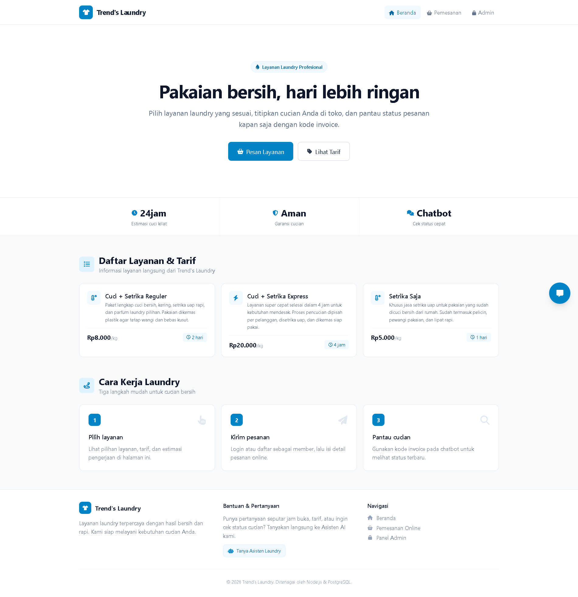
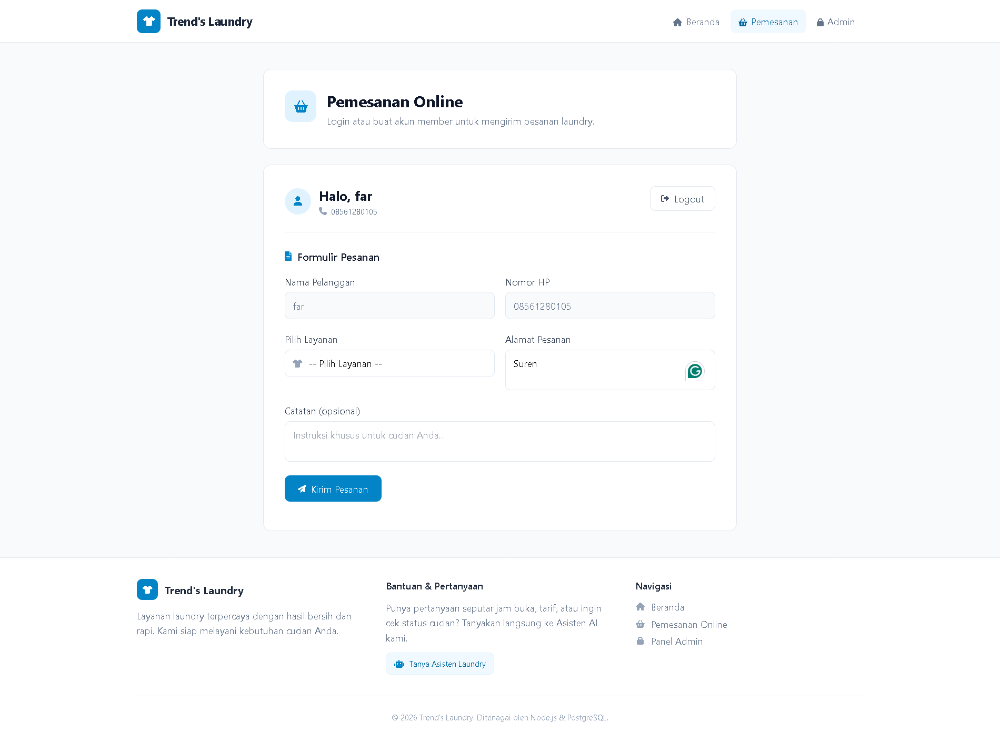
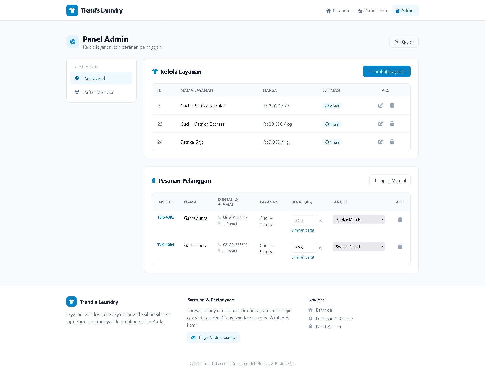

# AI Chatbot Trend's Laundry

Aplikasi web laundry untuk menampilkan layanan dan tarif, membuat pesanan online, mengelola pesanan dan produk, serta menggunakan chatbot berbasis Google Gemini.

## Fitur Utama

- Beranda dengan informasi layanan, tarif, alur pemesanan, dan chatbot.
- Pendaftaran, login, dan logout member.
- Pemesanan online untuk member yang sudah login.
- Pengecekan status pesanan menggunakan kode invoice.
- CRUD layanan atau produk untuk admin.
- Pengelolaan status pesanan, daftar member, dan berat cucian oleh admin.
- Chatbot Gemini yang membatasi jawaban pada konteks layanan Trend's Laundry.

## Tampilan Website

Simpan tangkapan layar pada folder `docs/screenshots/`, lalu ganti nama file pada bagian berikut.

### Beranda



### Halaman Pemesanan



### Panel Admin



## Teknologi

- Node.js dan Express 5
- PostgreSQL dan Sequelize 6
- EJS untuk template halaman
- Express Session
- Google Gemini API
- Tailwind CSS dan Font Awesome pada frontend
- Node.js Test Runner untuk pengujian

## Struktur Project

```text
app.js          Bootstrap server Express
config/         Konfigurasi aplikasi, database, dan Gemini
controllers/    Handler HTTP untuk halaman, admin, member, produk, pesanan, dan chat
middlewares/    Autentikasi, validasi input, dan logging
migrations/     Migrasi database untuk member dan berat pesanan
models/         Model Sequelize untuk Produk, Pesanan, dan Member
public/         Asset CSS dan JavaScript browser
routes/         Route halaman, API, dan chatbot
services/       Operasi database dan integrasi Gemini
utils/          Helper aplikasi
views/          Template EJS
tests/          Unit, route, controller, service, dan integrasi
docs/screenshots/ Tangkapan layar dokumentasi
```

## Persyaratan

- Node.js 18 atau lebih baru
- PostgreSQL
- API key Google Gemini

## Konfigurasi dan Menjalankan Project

1. Install dependencies:

   ```powershell
   npm install
   ```

2. Buat file `.env` dari contoh konfigurasi:

   ```powershell
   Copy-Item .env.example .env
   ```

3. Isi konfigurasi database, Gemini, sesi, dan kredensial admin pada `.env`:

   ```dotenv
   PORT=3000
   NODE_ENV=development

   DB_HOST=localhost
   DB_PORT=5432
   DB_USER=postgres
   DB_PASSWORD=your_password_here
   DB_NAME=your_database_name

   GEMINI_API_KEY=your_gemini_api_key_here
   GEMINI_MODEL=gemini-3.1-flash-lite

   SESSION_SECRET=your_random_secret_at_least_32_bytes
   ADMIN_USERNAME=admin
   ADMIN_PASSWORD=your_strong_admin_password
   ```

4. Pastikan database PostgreSQL pada `DB_NAME` sudah dibuat.
5. Jalankan aplikasi:

   ```powershell
   npm start
   ```

6. Buka `http://localhost:3000`.

Jangan commit file `.env`, API key, atau password database. Untuk development, `SESSION_SECRET` yang belum diisi dapat dibuat secara acak saat proses server dimulai, tetapi harus dikonfigurasi secara eksplisit saat `NODE_ENV=production`.

## Migrasi Database Lama

Saat aplikasi dimulai, Sequelize menjalankan `sync()` untuk membuat tabel baru tanpa opsi `alter` atau `force`. Kolom dan tabel pada database lama tidak berubah secara otomatis.

Jalankan migrasi berikut sebelum menggunakan fitur member dan berat pesanan:

```powershell
psql -h localhost -p 5432 -U postgres -d nama_database -f migrations/20261116_create_members.sql
psql -h localhost -p 5432 -U postgres -d nama_database -f migrations/20261116_add_pesanan_berat_kg.sql
```

Migrasi member membuat tabel `member` dan menambahkan relasi `pesanan.member_id`. Migrasi berat menambahkan kolom nullable `pesanan.berat_kg`.

## Route Halaman

- `/` - Beranda dan chatbot.
- `/pemesanan` - Login atau pendaftaran member serta form pemesanan.
- `/admin` - Panel admin; akses pengelolaan memerlukan login admin.

## Endpoint Utama

| Method | Endpoint | Akses | Keterangan |
| --- | --- | --- | --- |
| `POST` | `/api/chat` | Publik | Mengirim pesan ke chatbot |
| `GET` | `/api/produk` | Publik | Mendapatkan daftar layanan |
| `POST` | `/api/member/register` | Publik | Membuat member dan sesi login |
| `POST` | `/api/member/login` | Publik | Login member |
| `GET` | `/api/member/session` | Member | Mengecek sesi member |
| `POST` | `/api/member/logout` | Member | Mengakhiri sesi member |
| `POST` | `/api/pesanan` | Member | Membuat pesanan |
| `GET` | `/api/pesanan/:kodeInvoice` | Publik | Mengecek status pesanan |
| `POST` | `/api/admin/login` | Publik | Login admin |
| `GET` | `/api/admin/session` | Admin | Mengecek sesi admin |
| `GET` | `/api/admin/members` | Admin | Melihat daftar member |
| `POST` | `/api/produk` | Admin | Menambah layanan |
| `PUT` | `/api/produk/:id` | Admin | Memperbarui layanan |
| `DELETE` | `/api/produk/:id` | Admin | Menghapus layanan |
| `GET` | `/api/pesanan` | Admin | Mendapatkan daftar pesanan |
| `PUT` | `/api/pesanan/:kodeInvoice` | Admin | Memperbarui status atau berat pesanan |
| `DELETE` | `/api/pesanan/:kodeInvoice` | Admin | Menghapus pesanan |

Nama dan nomor HP pesanan online diambil dari profil member di server. Berat cucian ditambahkan admin setelah penimbangan.

## Pengujian

Tes unit dan route menggunakan mock:

```powershell
npm test
```

Tes integrasi bersifat opt-in dan memerlukan konfigurasi PostgreSQL serta Gemini:

```powershell
npm run test:integration
```

Tes PostgreSQL hanya membaca data `produk`. Tes Gemini mengirim satu permintaan dan dapat menggunakan kuota API.

## Repository

Project ini menggunakan repository:

[PAW-Project-AI_Chatbot_Untuk_Trend-s_Laundry](https://github.com/EternalSippingTea/PAW-Project-AI_Chatbot_Untuk_Trend-s_Laundry)
